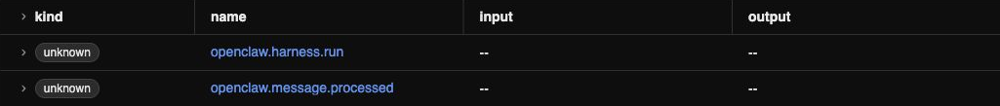
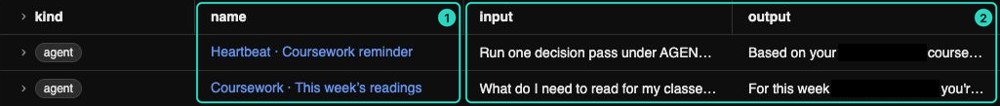
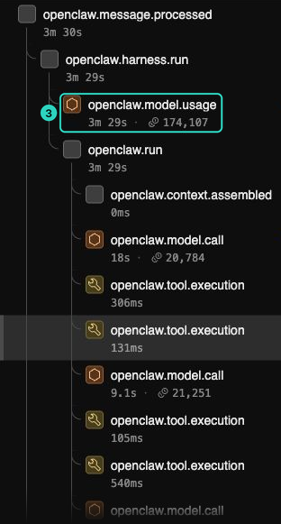
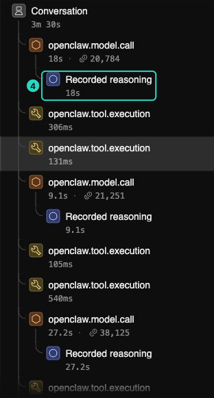
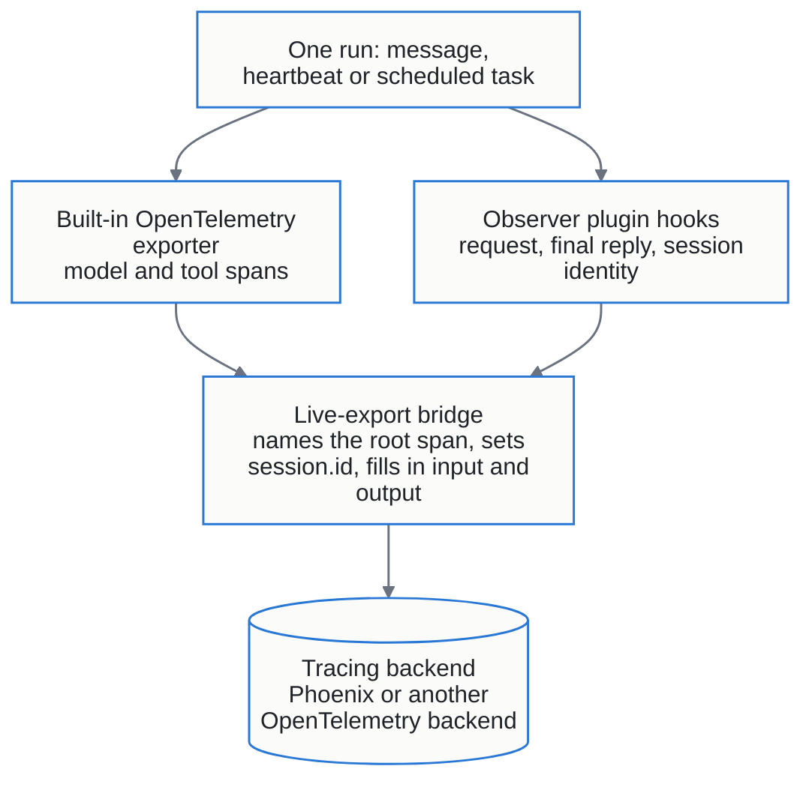
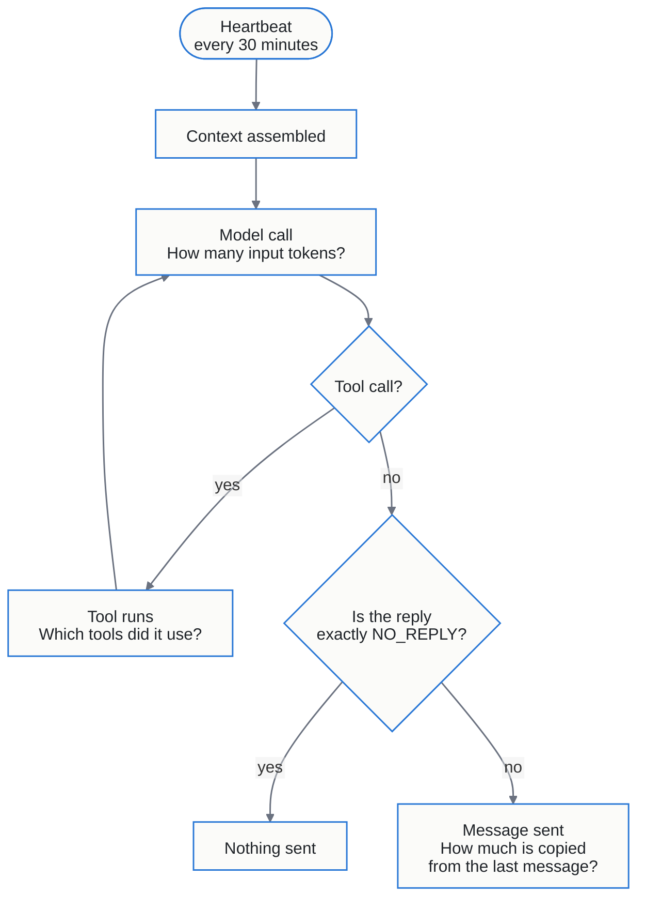
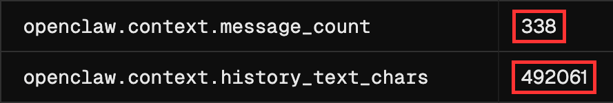
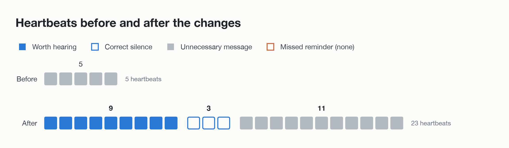
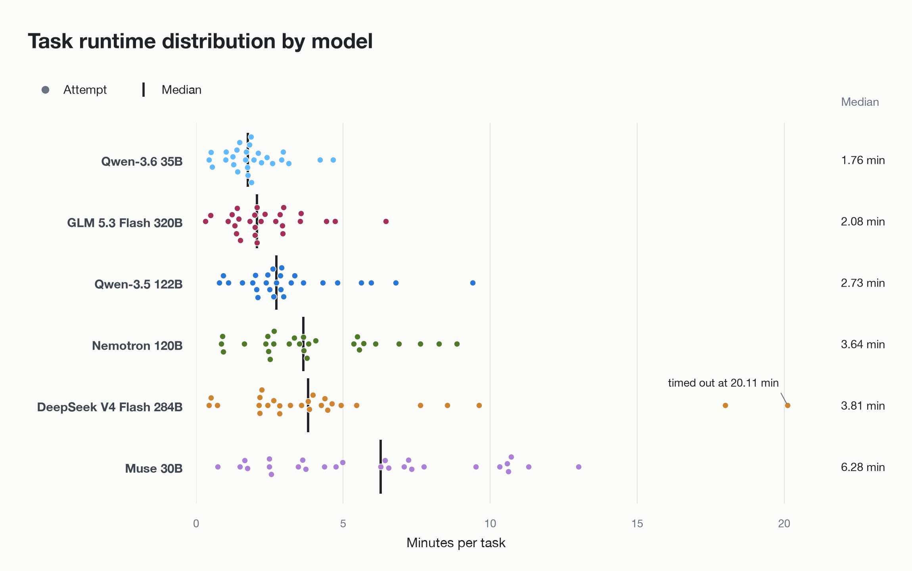

# Evaluating and improving an always-on AI assistant

*A practical guide to evaluating an agent, from its scheduled check-ins to its everyday tasks.*

I run [OpenClaw](https://github.com/openclaw/openclaw), an open-source personal assistant, on my own hardware with a locally hosted model. Every 30 minutes a scheduled cron job, called a heartbeat, wakes it to decide whether any work needs doing or anything needs my attention. It kept repeating old information or burying useful updates in long messages.

Other users have reported similar problems. In one [GitHub issue](https://github.com/openclaw/openclaw/issues/142588), 96% of heartbeats sent messages about what the assistant planned to do, without sharing a relevant result.

My assistant's answers to everyday requests, such as planning a study week or finding flights, also got details wrong. This guide shows how I found the causes and tested fixes with OpenClaw and [Phoenix](https://github.com/Arize-ai/phoenix), an open-source tracing and evaluation tool. *The steps apply to any agent that calls tools on a schedule, and the traces are standard [OpenTelemetry](https://opentelemetry.io/), so other tracing backends can read them too.*

## Key findings

| Finding | |
|---|---|
| Each heartbeat was re-reading the entire chat history | A fresh session for each heartbeat cut the first prompt (188k → 21k tokens) |
| Heartbeat messages were reaching me by mistake | The harness only suppresses a message when it contains `NO_REPLY` and nothing else |
| Every run in the default traces looked the same | I built an [observer plugin](#make-the-traces-readable) that names each run by what started it and shows what it was asked and what it answered |
| A calibrated LLM judge agreed with my labels on 20/24 heartbeats | Cohen's κ 0.73, agreement corrected for chance |
| Choosing GLM over DeepSeek cut the time per task almost in half | **GLM 5.3 Flash:** 21/27 complete, 2.1 min/task<br>**DeepSeek:** 24/27 complete, 3.8 min/task, *though the completion gap isn't significant (p = 0.47)* |

[](figures/model-completion-time.png)

*Six models ran nine everyday tasks, three attempts each. The chart plots median time per task against completion rate, how often an LLM judge marked an attempt complete. GLM 5.3 replaced Qwen-3.5 as my main model after this analysis.*

## How the assistant works

![A hand-drawn diagram. A chat message or a scheduled heartbeat starts a run in the harness, drawn as the largest box, and the reply goes back to the chat. The harness builds the context, shown as three strips in which conversation history is far longer than instructions or memory, and calls tools such as files, calendar, reminders and web. Four numbered arrows carry the context to the LLM, a tool call back, the tool result out and the answer back. The tool call and result repeat until the LLM answers. A dashed frame labeled Tracing backend surrounds the harness and the LLM, and along its bottom a span timeline shows one run containing an LLM call, a tool call and a second LLM call.](figures/model-and-harness-v2.png)

An agent is a model plus the harness that runs it. Following [Hugging Face's agent glossary](https://huggingface.co/blog/agent-glossary), this guide also separates out the scaffold, the part that shapes the model's behavior, to show which layer each change touches.

| Layer | Description | In my assistant | What I changed |
|---|---|---|---|
| Model | The LLM, which turns text into text with no loop or memory of its own | Qwen-3.5 122B | Switched to GLM 5.3 Flash |
| Scaffold | Shapes behavior through instructions, tool descriptions and how the reply is parsed | Heartbeat instructions, tool descriptions, the `NO_REPLY` rule | Rewrote the heartbeat prompt and added 12 MCP tools |
| Harness | Runs the loop, calling the model, running its tool calls and deciding when to stop | OpenClaw, which also decides what history and memory go into the context | A fresh session for each heartbeat |

```python
def run_assistant(trigger):
    context = build_context(trigger)             # harness assembles instructions, memory, history
    while True:
        reply = model(context, tools)            # model
        if reply.wants_tool:
            context += [reply, run_tool(reply)]  # harness runs the tool
        else:
            break                                # harness: stop when no tool is requested
    if reply.text.strip() == "NO_REPLY":         # scaffold: how the reply is parsed
        return                                   # nothing is sent
    send_to_chat(reply.text)
```

## The loop


The sections below apply these steps to live heartbeats first, then to a benchmark of nine tasks I built to compare instructions, tools and models.

## Enable tracing

A trace, also called a trajectory, records one run. It holds the context that was assembled, each model call with its token counts, each tool call with its arguments and result, and the final response. Each step is a span within that trace. Every measurement in this guide starts from a trace.

OpenClaw exports traces through its OpenTelemetry plugin. The instructions below send them to Phoenix, and another backend needs only its own endpoint and headers.

<details>
<summary><b>Set up tracing</b> (OpenClaw to Phoenix Cloud, or to a local Phoenix Docker instance)</summary>

<br>

These examples enable `captureContent`, which stores prompts, responses, and tool inputs and outputs in the tracing backend. With Phoenix Cloud, that content is sent to Arize's hosted service. With the local option it stays on your machine.

Back up your current configuration first.

```bash
cp ~/.openclaw/openclaw.json ~/.openclaw/openclaw.json.bak.$(date +%Y%m%d-%H%M%S)
```

Install and enable the OpenTelemetry plugin.

```bash
openclaw plugins install @openclaw/diagnostics-otel
openclaw plugins enable diagnostics-otel
openclaw plugins list
```

**Option A: Phoenix Cloud**

1. Open your Phoenix Cloud space at [app.phoenix.arize.com](https://app.phoenix.arize.com) and go to **Settings** to create an API key and find your collector endpoint.
2. Add `PHOENIX_API_KEY=<your key>` to `~/.openclaw/.env`. Keep this file out of version control.
3. Merge the following `diagnostics` section into the top-level object of `~/.openclaw/openclaw.json`. Do not replace your whole configuration. Replace `<space>` with your Phoenix space identifier and keep `${PHOENIX_API_KEY}` exactly as written. OpenClaw reads the value from its environment.

```json
{
  "diagnostics": {
    "enabled": true,
    "otel": {
      "enabled": true,
      "protocol": "http/protobuf",
      "tracesEndpoint": "https://app.phoenix.arize.com/s/<space>/v1/traces",
      "headers": { "Authorization": "Bearer ${PHOENIX_API_KEY}" },
      "traces": true,
      "metrics": false,
      "logs": false,
      "sampleRate": 1,
      "captureContent": true
    }
  }
}
```

**Option B: Phoenix on your own machine**

1. With Docker running, create a persistent volume and start Phoenix. This exposes it only on your own machine, at [http://127.0.0.1:6006](http://127.0.0.1:6006).

```bash
docker volume create phoenix-local-data

docker run -d \
  --name phoenix-local \
  -p 127.0.0.1:6006:6006 \
  -e PHOENIX_WORKING_DIR=/mnt/data \
  -v phoenix-local-data:/mnt/data \
  arizephoenix/phoenix:version-20.26.1
```

2. Merge the following `diagnostics` section into `~/.openclaw/openclaw.json`. The localhost endpoint assumes the OpenClaw gateway and Phoenix run on the same host. A gateway inside a container needs an endpoint it can reach.

```json
{
  "diagnostics": {
    "enabled": true,
    "otel": {
      "enabled": true,
      "protocol": "http/protobuf",
      "tracesEndpoint": "http://127.0.0.1:6006/v1/traces",
      "traces": true,
      "metrics": false,
      "logs": false,
      "sampleRate": 1,
      "captureContent": true
    }
  }
}
```

**Either option:** validate and restart the gateway.

```bash
openclaw config validate
openclaw gateway restart
```

</details>

### Make the traces readable

The root span stands for the whole run, and the model calls, tool calls and reasoning nest under it. By default, every root had a generic name and no record of what the run was asked or what it answered, so I couldn't tell the runs apart in the list. I built an observer [plugin](observer/) that fixes this by adding [OpenInference](https://github.com/Arize-ai/openinference) attributes, the format Phoenix reads.

| Trace detail | Default | With the plugin |
|---|---|---|
| ① Root span name | `openclaw.harness.run` or `openclaw.message.processed` | Heartbeat, Conversation, Scheduled task or Evaluation |
| ② `input.value`, `output.value` | Missing | What the run was asked and what it answered |
| ③ Token counts | An extra span repeats the run's total, so tokens count twice | Usage per model call, with the total on the run |
| ④ Reasoning | Not exported | Recorded under each model call when `captureReasoning` is `text` |
| `session.id` | Missing | Each conversation has a unique ID |

Here are two runs in the Phoenix trace list, first with the default export and then with the plugin.

<table>
  <tr><th>Default export</th></tr>
  <tr><td></td></tr>
  <tr><th>With the plugin</th></tr>
  <tr><td></td></tr>
</table>

Inside the conversation, the plugin stops counting the run's tokens twice and shows the recorded reasoning under each model call.

<table>
  <tr>
    <th width="50%">Default export</th>
    <th width="50%">With the plugin</th>
  </tr>
  <tr>
    <td></td>
    <td></td>
  </tr>
</table>

<a id="observer-plugin"></a>
<details>
<summary><b>Install the observer plugin</b> (verified against OpenClaw 2026.9.5)</summary>

<br>

The plugin's ID is `phoenix-eval-observer`. It has two parts. The **observer hooks** record each run's visible prompt, final reply, tool calls and timings to local JSONL files, with credentials redacted and system prompts, reasoning and media left out. The optional **live-export bridge** patches the installed OpenTelemetry exporter so the traces it already sends carry a readable root span, the request and reply, a session identifier and the tool names in each model call's messages. Nothing in the plugin changes a prompt, a tool call, the model, memory or the result, and a capture failure never blocks the run.



**Configuration.** Merge this entry into `plugins.entries` in `openclaw.json` without replacing other plugins. The plugin records only the sessions of the agent named by `agentId`, so set it to your own agent's ID. It records nothing until you do.

```json
{
  "plugins": {
    "entries": {
      "phoenix-eval-observer": {
        "enabled": true,
        "hooks": { "allowConversationAccess": true, "allowPromptInjection": false },
        "config": {
          "agentId": "<agent-id>",
          "outputDir": "/Users/<you>/.openclaw/phoenix-evals",
          "captureReasoning": "none",
          "sessionScope": "all",
          "liveExport": true
        }
      }
    }
  }
}
```

| Option | Values | Effect |
|---|---|---|
| `agentId` | Your agent's ID | Required<br>Only sessions whose key starts with `agent:<agent-id>:` are recorded, and an event that names another agent is ignored before its content is read |
| `outputDir` | A directory path | Where the JSONL records go<br>It defaults to `~/.openclaw/phoenix-evals`<br>Directories are created with mode `0700` and files with `0600` |
| `captureReasoning` | `none`, `size`, `text` | Leave reasoning out, record only its length, or record the text, bounded and credential-redacted<br>Reasoning is where personal detail is densest<br>Use `text` only when you intend to upload it |
| `sessionScope` | `eval`, `all` | Record only sessions tagged for evaluation, or every conversation, heartbeat and scheduled task of the configured agent |
| `liveExport` | `true`, `false` | Enrich the exporter's traces as described above<br>Requires the patched exporter |

In Phoenix, set the destination project with `diagnostics.otel.headers["x-project-name"]`. Keeping everyday conversations, isolated evaluations and reconstructed traces in separate projects keeps the populations comparable later.

**Installation.** The patch was built against `@openclaw/diagnostics-otel` 2026.9.5. Rebuild it after a plugin update.

1. Back up the installed observer directory, the exporter's runtime file and your configuration, with a timestamp.
2. Run `npm test` in `observer/`. The tests use fixtures only, with no model calls or exports.
3. Build the patched exporter with `observer/patch-native-exporter.py`, passing the exact upstream source file, an output path and the installed observer directory.
4. At an idle moment, copy the observer files and the patched exporter into place and merge the configuration entry above.
5. Restart the gateway and check plugin and gateway health. Hot reload left a stale plugin reference on my version, so restart cleanly.
6. Send two ordinary messages and confirm they share one session ID but have separate trace IDs, then open a trace and check the request, reply and tool steps. To capture reasoning traces, set `captureReasoning` to `text`.

**Rollback.** At an idle moment, restore the backed-up exporter file and observer directory, restore the plugin's configuration entry, restart and check health. Avoid restoring the whole configuration file over unrelated changes made since.

**What is recorded, and the limits.**

- `llm_input` and `llm_output` describe the visible prompt and reply of one attempt, with the provider, model, history messages, assistant text and aggregate usage. The system prompt is stored as a hash and a character count. Reasoning blocks and image, audio and video payloads are omitted.
- Tool hooks record the tool name, call ID, sanitized parameters, the visible result, any error and the duration. Model-call hooks record timing and outcome without model content.
- Strings are cut at 16,000 characters with an explicit truncation marker. Arrays and objects keep 100 items to a depth of 8. These limits can truncate evidence.
- Credential redaction is pattern-based. It does not anonymize personal information inside tool results.
- The hooks observe on a best-effort basis, so a run that dies before its terminal event stays incomplete. An exported reply is not proof that a message was delivered, and recorded reasoning is the text the model emitted, which does not show its computation.
- The reference for every field is [observer/README.md](observer/README.md).

</details>

## Start with deterministic checks

Each question in this diagram can be answered programmatically from a heartbeat's trace.



<details>
<summary><b>Pull past heartbeats</b> (from OpenClaw's transcript store)</summary>

<br>

This [script](scripts/extract_heartbeats.py) retroactively pulls each heartbeat's recorded output, tool calls and token usage from OpenClaw's transcript store, and attempts to strip any contact information and credential patterns. Set `--host` to the SSH destination of the machine running OpenClaw.

```bash
python3 -m scripts.extract_heartbeats --host user@host --since YYYY-MM-DD
```

</details>

The deterministic checks showed that my assistant was copying messages it had already sent, word for word, and appending `NO_REPLY`, which did not stop them from being delivered. That pointed at the harness, for the history it was feeding each run, and at the scaffold, for the wording of the heartbeat prompt. The fixes are in [Change one thing at a time](#change-one-thing-at-a-time).

## Decide what messages you want to receive

Whether a message was worth sending depends on what I want to hear, so I labeled a sample of heartbeats myself. The labels on heartbeats from before the changes became the baseline every fix is measured against. Labeling also helps you decide the criteria, since people tend to refine them as they grade real outputs, which [Shankar et al.](https://arxiv.org/abs/2404.12272) call criteria drift.

For an assistant that chooses between speaking and staying quiet, the question has two parts. Was there something I needed to hear, and did it speak? That gives four outcomes, and two of them are failures.

|  | Something needed my attention | Nothing did |
|---|---|---|
| **It sent a message** | `useful`, or `somewhat_useful` when buried in a long message | `redundant` |
| **It stayed silent** | `missed` | `correct_silence` |

Add `unsure` for runs where the evidence cannot support a decision, and count a crash or timeout separately from a deliberate silence.

## Use an LLM judge

Next, I checked whether an LLM judge would produce the same labels as mine. I also compared it with a trivial judge that always picks the most common label, since that alone scores well on raw agreement.

I used GPT-6 Sol as the judge, with [this prompt](prompts/heartbeat-judge.md).

| Judge | Agreed with my labels |
|---|---|
| GPT-6 Sol | 20/24 (83%), Cohen's κ 0.73 |
| Always `redundant` | 13/24 (54%) |

Read each disagreement as well as the rate. The worst of the four called a missed reminder a correct silence, which would hide the failure you are looking for.

<details>
<summary><b>The four disagreements</b></summary>

<br>

- For the missed reminder, it reasoned that a chat reply minutes earlier had already mentioned it, but I count only a heartbeat message as a reminder.
- It dismissed one message that I thought contained useful new information.
- It was unsure about two silences I considered correct. Neither run had checked the calendar or reminders, so the judge had no evidence to decide with.

</details>

> [!TIP]
> Save the judge's labels on the traces. In Phoenix they become annotations, so you can filter for every heartbeat labeled `redundant` and read the messages behind them.
> The [judge script](scripts/judge_heartbeats.py) runs the judge and scores it against your labels, and the [appendix](#heartbeat-judge-methodology) explains how I chose the judge model.

## Change one thing at a time

If your assistant keeps repeating itself, check what the harness puts in its context, then what its instructions say about staying quiet, then whether it checked current sources before deciding. I changed them in that order, and each change fixed one problem and exposed the next.

| Change | Fixed | Exposed |
|---|---|---|
| Fresh sessions | Copied messages | Messages still sent with `NO_REPLY` at the end |
| Rewritten heartbeat prompt | Messages with `NO_REPLY` attached | Two silences while an urgent reminder was due, the first with no tool calls |
| Calendar and reminder check before silence | Missed reminders | A reminder sent again after it had already gone out |

### Harness: give each heartbeat a fresh session

When a scheduled run copies an earlier message, check how much history went into its context. In Phoenix, filter for the `openclaw.context.assembled` span. At first, each of my heartbeats carried 333–338 earlier messages, nearly half a million characters of conversation history.



*The assembled-context span of one heartbeat.*

Starting each heartbeat in a fresh session fixes this. In OpenClaw, that takes one setting in the heartbeat configuration.

```json
"heartbeat": { "isolatedSession": true }
```

Fresh sessions cut the copying and shrank the first prompt (188k → 21k tokens).

### Scaffold: ask for silence the way the harness expects

My old prompt told the model to *end with* `NO_REPLY`, so it wrote a summary first, added the token, and the whole message was delivered. The fix was one sentence of the heartbeat prompt.

```diff
- For no meaningful change, end with exactly NO_REPLY.
+ For no meaningful change, the entire reply is exactly NO_REPLY:
+ nothing before it and nothing after it.
```

<details>
<summary><b>Heartbeat output before and after the fix</b></summary>

<br>

<table>
  <tr>
    <th width="50%">Last heartbeat under the old instructions</th>
    <th width="50%">First heartbeat under the new instructions</th>
  </tr>
  <tr>
    <td></td>
    <td></td>
  </tr>
  <tr>
    <td>Text before <code>NO_REPLY</code> meant the message was delivered</td>
    <td>The whole reply is <code>NO_REPLY</code>, so nothing is sent</td>
  </tr>
</table>

</details>

## Repeat on new heartbeats

After the changes, label a new sample the same way. Of the 23 heartbeats I labeled the next day, all checked the calendar and reminders, none appended `NO_REPLY` to a longer message and none missed a reminder, but 11 still sent a message I didn't need. Cutting the context only helps the user if the decisions get better too.



*Both rows ran Qwen-3.5 122B, before the switch to GLM.*

---

## 🧪 Write your own benchmark

The heartbeat work revealed why my assistant repeated itself, sent messages with `NO_REPLY` appended and missed a reminder. Comparing instructions, tools and models on everyday requests needs the same tasks every time, so I built a benchmark from nine tasks I actually want my assistant to do.

| Area | Tasks |
|---|---|
| Coursework | Finding this week's course readings, planning for an upcoming assignment, making a study plan |
| Events | Getting ready for a hackathon, preparing for a conference, following up after an event |
| Travel | Finding flights for a trip |
| Model training and research | Calculating LoRA parameters, finding a benchmark for AI agents |

Choose tasks that use different tools, and write down what a good answer needs to include before running them. Start each attempt, also called a rollout, in a fresh session with earlier answers and drafts removed, so one attempt can't borrow from another (I started each one from a fresh copy of the same workspace).

## Check what each judge measures

For the benchmark tasks, I ran five of Phoenix's built-in evaluators with GPT-6 Sol and their default instructions. Each asks a different question.

- **Task completion:** Did it fulfill the user's request fully?
- **Faithfulness:** Is the response grounded in the information it retrieved?
- **Tool selection:** Did it choose the right tool for the job?
- **Retrieval relevance:** Is any of the retrieved information relevant to the request?
- **Tool response handling:** Did it use that information correctly?

The judges also need complete inputs. At first, they got tool results cut off at 8,192 characters and shortened answers, so I rebuilt the inputs to include AGENTS.md (the assistant's instructions file), the full answers and tool results of up to 150,000 characters.

[](figures/judge-pass-rates.png)

*Each dot is one model. Task completion and tool selection count all 27 attempts per model. The other three judges only score answers with tool results, 23 or 24 per model, because every model answered the LoRA calculation without tools.*

<details>
<summary><b>Exact pass rates</b></summary>

<br>

| Model | Task completion<br>of 27 | Tool selection<br>of 27 | Faithfulness<br>of 23–24 | Tool response handling<br>of 23–24 | Retrieval relevance<br>of 23–24 |
|---|---|---|---|---|---|
| DeepSeek V4 Flash 284B | 89% | 41% | 26% | 17% | 100% |
| GLM 5.3 Flash 320B | 78% | 44% | 21% | 13% | 100% |
| Qwen-3.5 122B | 70% | 70% | 17% | 13% | 100% |
| Nemotron 120B | 67% | 33% | 4% | 0% | 100% |
| Muse 30B | 63% | 41% | 17% | 4% | 100% |
| Qwen-3.6 35B | 59% | 44% | 4% | 0% | 100% |

</details>

The same answers score 59–89% on task completion but 4–26% on faithfulness, and retrieval relevance passes everything, so pick the judge that matches the question you're asking.

> [!IMPORTANT]
> Before you trust a judge's number, know what it receives, how often it agrees with you on cases you have reviewed, and in which direction it is wrong when it disagrees.

## Compare instructions, tools and models

With the benchmark and judges in place, I changed one thing at a time. Make each change address a problem you found, then rerun the whole benchmark, including the tasks that already worked.

### Scaffold: add a final check to the instructions

My assistant often misread information it had already found, so I tested an instruction to check each answer before sending it. The check asks whether the answer covers the whole request and whether its dates, prices and time slots match what the assistant retrieved.

I ran each version once per task, and the check added about 6% more tokens.

- **Fixed:** it corrected an event deadline.
- **Broke:** finding this week's course readings. In the trace, the revised run read only the course's index pages and never opened the documents, so it returned no reading links.

### Scaffold: add the tools it was missing

When my assistant wasn't capable enough, I added tools, then checked whether it used them correctly. The 12 new tools connect through [MCP](https://modelcontextprotocol.io/) (Model Context Protocol) and include flight search and a Canvas integration (my university's course site). I kept the original prompt, so the tools were the only change.

- **Fixed:** every flight attempt found specific itineraries for the requested dates, where earlier runs had returned general fares for other months.
- **Still wrong:** the answers mixed up details from different offers, including layover cities.

### Model: run each candidate more than once

I tested six models on the nine tasks, three attempts per task, including my assistant's model at the time, Qwen-3.5 122B. The [scatter plot at the top of this guide](#key-findings) compares median time per task with completion rate.

- **DeepSeek** had the highest completion rate, 24/27 attempts, at about 3.8 minutes per task.
- **GLM 5.3 Flash** completed 21/27 in about half the median time. With 27 attempts each, the completion gap isn't significant (Fisher's exact test, p = 0.47), so speed decided my switch to GLM.
- **Qwen-3.6** was the fastest at 1.76 minutes and had the lowest completion rate, 16/27.
- **Muse 30B** was the slowest at 6.28 minutes.

<a id="runtime-distribution"></a>

I also looked at every individual runtime, in case a fast median was hiding occasional long waits.

[](figures/runtime-distribution.png)

*Each dot is an attempt. Black ticks mark medians, and rows are ordered by them. Hardware and serving settings differed. [Methodology](#runtime-distribution-methodology).*

GLM's slowest attempt took 6.5 minutes. DeepSeek's took 18, and another timed out at 20.11.

Five of the six models sometimes used the previous year's weekdays for current dates. Of the weekdays in their study plans, Qwen-3.6 got 1/33 right, GLM 31/41 and DeepSeek 25/25.

## Troubleshoot your assistant

| Symptom | Inspect in the trace | Change to test |
|---|---|---|
| **Repeats earlier messages** | The assembled context and its size | A fresh session per heartbeat (`isolatedSession: true`) |
| **Sends a message ending in `NO_REPLY`** | The exact final output | Require the whole reply to be `NO_REPLY` when there's nothing to send |
| **Stays silent when a reminder is due** | Calendar and reminder tool calls | Require both lookups before any silence |
| **Repeats a reminder already sent** | Whether earlier reminders are in the model input | A sent-message log it checks before sending |
| **Gives details that contradict its sources** | The final answer next to the tool results | A final check against the evidence, then rerun the whole benchmark |
| **Takes too long or times out** | Time spent in model and tool calls | If model calls dominate, try another model on the same tasks |
| **Judge score conflicts with the evidence** | The judge's explanation and inputs | Give the judge the missing context and rerun it on reviewed examples |

## Summary

To apply the same loop to your own agent, enable tracing, start with deterministic checks, decide what a good result looks like, bring in an LLM judge once it agrees with your labels, and measure one change at a time. Every fix in this guide started from something visible in a trace.

## What I would do next

- Does a sent-message log, read before each decision, keep the assistant from sending the same reminder twice? Add one, rerun the deterministic checks and let the judge label the new sample.
- Does telling the assistant to open the documents it finds bring back the course readings without losing the deadline fix?
- How much do live sources move between runs? Record the timestamps of flight searches and course pages so that reruns can be compared.

## Appendix

<a id="heartbeat-observation-records"></a>
<details>
<summary><b>Heartbeat observation records</b> (27 heartbeats across five configurations)</summary>

<br>

| Measure | Whole week's chat | Shorter chat | Fresh sessions | Prompt rewrite | Calendar and reminder checks |
|---|---|---|---|---|---|
| Heartbeats | 5 | 3 | 11 | 6 | 2 |
| First-call prompt, median tokens | 188k | 53k | 21k | 21k | 27k |
| Tokens per heartbeat, median | 373k | 106k | 94k | 45k | 62k |
| Lines copied from previous message, recorded range | 78–100% | 0% | 0–29% | Not recorded | Not recorded |
| Tool calls per heartbeat, range | 0–2 | 2 | 3–12 | 0–6 | 3–4 |
| Messages with `NO_REPLY` appended | 5 | 0 | 2 | 0 | 0 |
| Bare `NO_REPLY` replies | 0 | 2 | 1 | 5 | 0 |
| Redundant messages | 5 | 1 | 6 | 0 | 2 |
| Somewhat useful messages | 0 | 0 | 4 | 1 | 0 |
| Correct silences | 0 | 2 | 1 | 3 | 0 |
| Missed reminders | 0 | 0 | 0 | 2 | 0 |

The changes overlapped in live use, along with other changes to the prompt, the tools and the hours the assistant stays quiet, so none was tested on its own.

</details>

<a id="heartbeat-judge-methodology"></a>
<details>
<summary><b>Heartbeat judge selection</b></summary>

<br>

To choose between GPT-6 Sol and GPT-6 Astra, each scored a separate set of 24 calibration cases three times. The cases were transcript excerpts and synthetic fixtures with proposed labels that had not been reviewed. Sol matched those labels on 67/72 runs and repeated the same label for 23/24 cases. Astra matched 59/72 and returned `unsure` 10 times. The proposed labels only selected the judge. The 83% agreement above comes from 24 of the 27 live heartbeats I labeled afterwards. The judge did not score the other 3.

</details>

<details>
<summary><b>Model observations and serving conditions</b></summary>

<br>

The results describe each model together with its serving setup. Most runs used a 20-minute task limit. All Qwen-3.5 passes and Qwen-3.6's first pass used 10 minutes and did not reach that limit. GLM 5.3 Flash 320B and DeepSeek V4 Flash 284B ran across two DGX Spark machines, and the other models ran on one. Every pass requested OpenClaw's medium reasoning setting, which GLM's and DeepSeek's servers mapped to high effort.

- **Time spent generating text.**
    - GLM generated about 98 characters per second, DeepSeek 147 and Muse 34.
    - Muse model calls took about 35 seconds against GLM's 10.
    - Most task time was in model calls, with tools taking seconds.
- **Invalid tool calls.**
    - Muse produced garbled calls in 7/27 attempts and repaired 12/19 rejected calls on the next turn.
    - Another 12 calls ran without a required argument. Twice, tool-call markup was delivered as the answer.
    - Qwen-3.6 had one rejected call and repaired it; the other models had none.
- **Concurrent tool calls.**
    - DeepSeek and Qwen-3.6 sent several calls together in 70–80% of their tool turns.
    - Nemotron called tools sequentially.
- **Form interactions.**
    - Qwen-3.6 filled out 12 registration fields on a form and requested missing details before offering submission.
    - No other model filled a form.
- **Explicit uncertainty.**
    - DeepSeek stated what it could not verify in 6/27 answers. No other model did so more than three times.

</details>

## Code

| Path | What it does |
|---|---|
| [`observer/`](observer/) | The plugin, with its hook recorder, live-export bridge, exporter patch builder and fixture tests (`npm test`) |
| [`scripts/extract_heartbeats.py`](scripts/extract_heartbeats.py) | Turns heartbeat runs from the transcript store into labelable cases, with contact and credential patterns removed |
| [`scripts/export_trace.py`](scripts/export_trace.py) | Converts reviewed hook records into OpenInference traces offline, and uploads them only with `--export` |
| [`scripts/judge_heartbeats.py`](scripts/judge_heartbeats.py) | Uploads labeled cases as a dataset, runs the judge as an experiment, scores agreement and pulls edited labels back |
| [`scripts/figures/`](scripts/figures/) | The scripts that draw each chart in this guide, the shared color roles in `palette.py`, and the sources of the two hand-drawn diagrams |
| [`figures/`](figures/) | The charts and captures shown in this guide |
| [`prompts/`](prompts/) | The heartbeat instructions [before](prompts/heartbeat-before.md) and [after](prompts/heartbeat-after.md) the rewrite, and the [judge prompt](prompts/heartbeat-judge.md) |

## Further reading

- [Harness, Scaffold, and the AI Agent Terms Worth Getting Right](https://huggingface.co/blog/agent-glossary) (Hugging Face): the model, scaffold and harness terms this guide uses.
- [A Field Guide to Rapidly Improving AI Products](https://hamel.dev/blog/posts/field-guide/) (Hamel Husain): error analysis and expert review.
- [Aligning LLM Evals with Human Feedback](https://arize.com/docs/phoenix/cookbook/human-in-the-loop-workflows-annotations/aligning-llm-evals-with-human-annotations-typescript) (Phoenix cookbook): checking judge decisions against human labels.
- [Improving Deep Agents with harness engineering](https://www.langchain.com/blog/improving-deep-agents-with-harness-engineering) (LangChain): experiments with changes to the application around a model.
- [Who Validates the Validators?](https://arxiv.org/abs/2404.12272) (Shankar et al.): aligning LLM-assisted evaluation with human judgment.
- [Proactive Agent](https://arxiv.org/abs/2410.12361) (Lu et al.): evaluating when an assistant should speak and when it should stay quiet.
