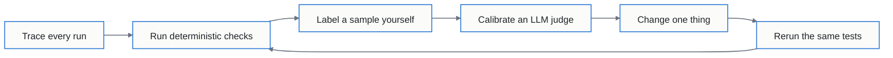
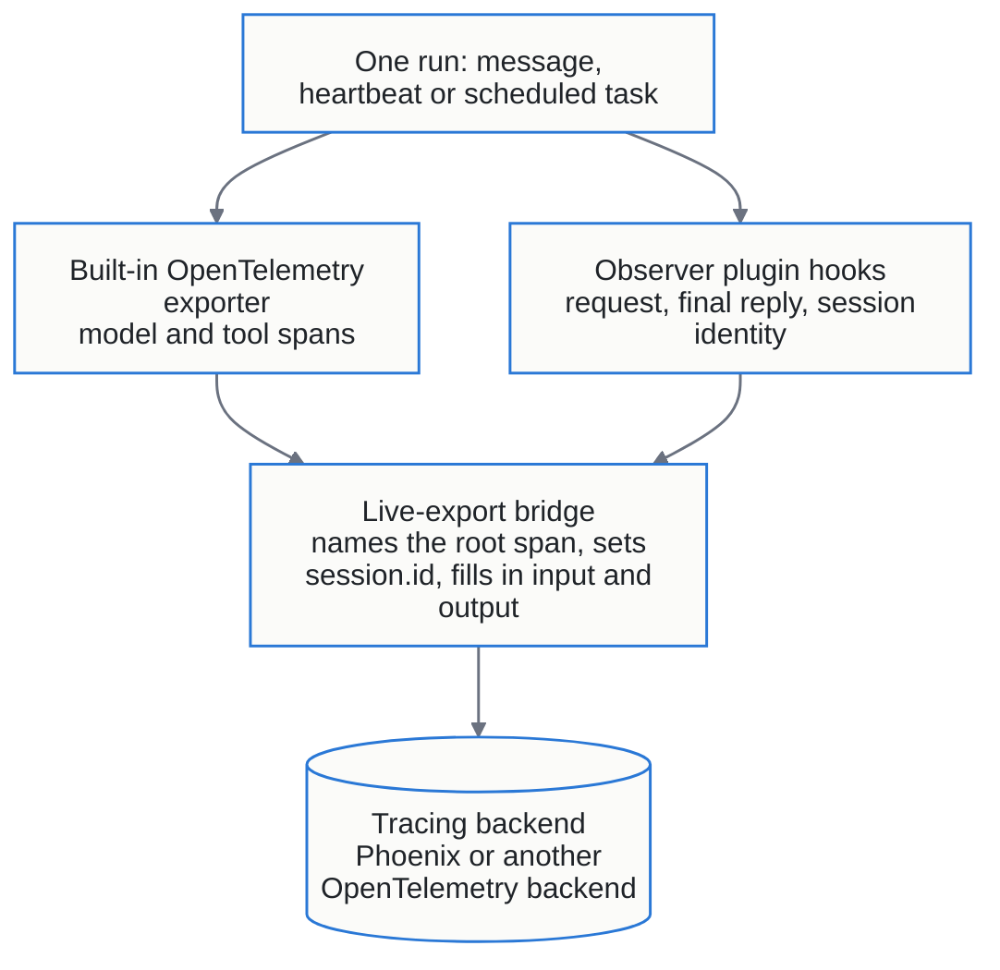
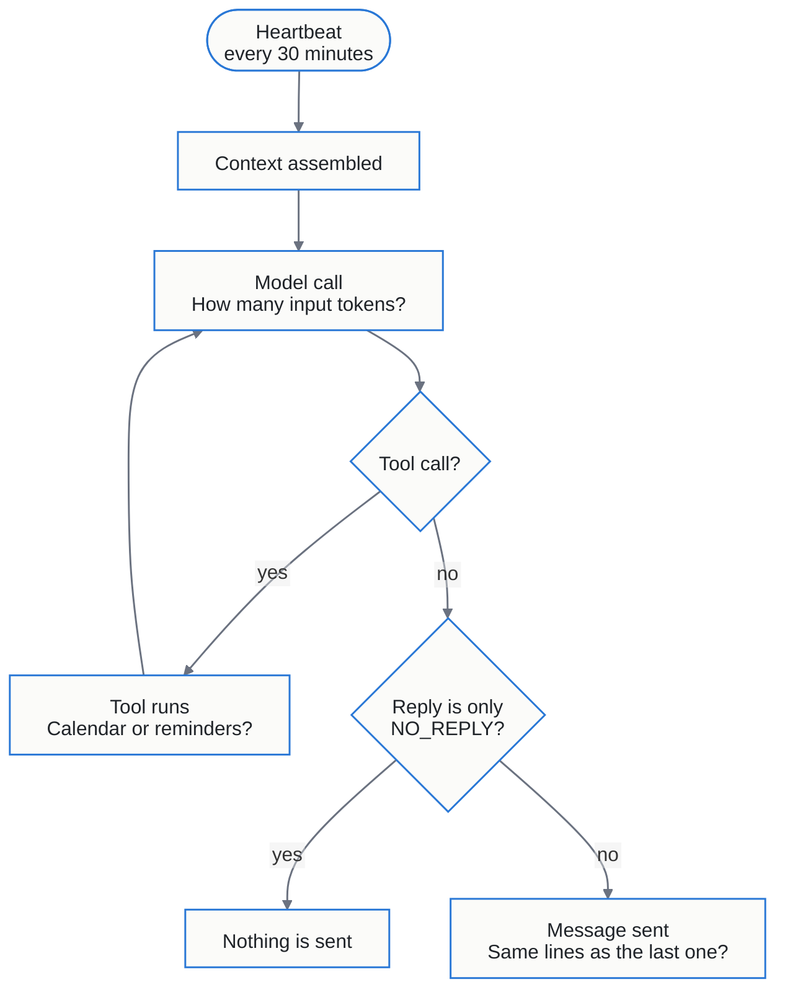
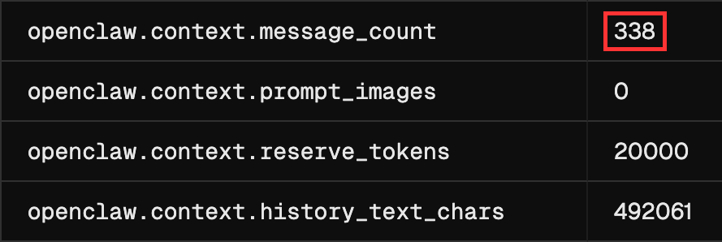
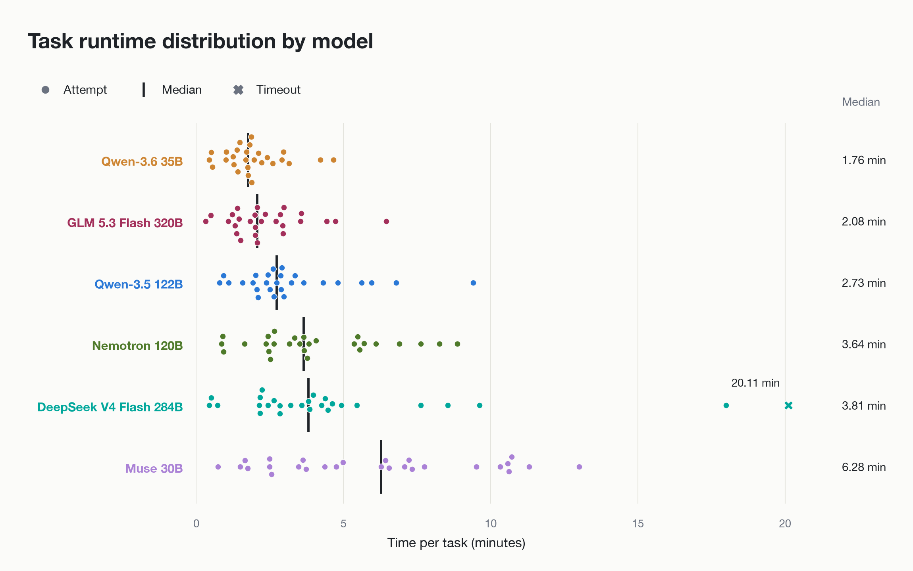
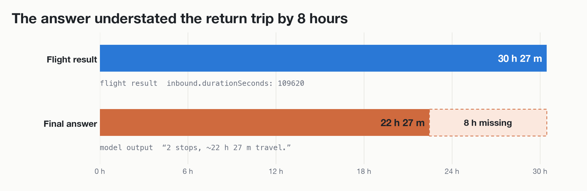

# Evaluating and improving an always-on AI assistant

*A practical guide to evaluating an agent that acts on a schedule.*

I run [OpenClaw](https://github.com/openclaw/openclaw), an open-source personal assistant, on my own hardware with a locally hosted model. Every 30 minutes a scheduled check, called a heartbeat, wakes it to decide whether anything needs my attention. It kept repeating old information or burying useful updates in long messages. Other users have run into the same delivery rule: in one [GitHub issue](https://github.com/openclaw/openclaw/issues/142588), 26/27 scheduled checks sent messages about what the assistant planned to do, without a result.

This guide is the method I used to find the causes and test fixes, with OpenClaw and [Phoenix](https://github.com/Arize-ai/phoenix), an open-source tracing and evaluation tool. The steps apply to any agent that calls tools on a schedule, and the traces are standard [OpenTelemetry](https://opentelemetry.io/), so other tracing backends can read them too.

## What I found

| Finding | Evidence |
|---|---|
| Each heartbeat was re-reading the whole week's chat | A fresh session for each heartbeat cut the first prompt (188k → 21k tokens). |
| All five baseline messages reached me by mistake | The instruction said to end with `NO_REPLY`, and OpenClaw suppresses a message only when the whole reply is exactly `NO_REPLY`. |
| The LLM judge and I agreed on 20/24 heartbeats | Cohen's κ 0.73, agreement corrected for chance. Its worst miss called a missed reminder a correct silence. |
| Choosing GLM over DeepSeek cut the time per task almost in half | **GLM 5.3 Flash:** 21/27 complete, 2.1 min per task<br>**DeepSeek:** 24/27 complete, 3.8 min per task<br>The completion gap could be chance (p = 0.47). |

[](figures/model-completion-time.png)

*Six local models on my nine everyday tasks, three attempts each: median time per task against the share of attempts an LLM judge marked complete. The ring marks GLM 5.3 Flash, which replaced Qwen-3.5 122B as my assistant's model.*

## The loop



## How the assistant works

![A hand-drawn diagram. A message or a scheduled heartbeat starts a run in the harness, drawn as the largest box. The harness builds the context, shown as three strips in which conversation history is far longer than instructions or memory, and runs tools. Four numbered arrows carry the context to the model, a tool call back, the tool result out again, and the answer back, and the harness delivers the reply to you. A dashed frame around the harness and the model is the tracing backend, which records each model call and tool call as a span.](figures/model-and-harness-v2.png)

*Blue is the harness and scaffold, the parts I changed. The outlined box is the model, which I compared.*

An agent is a model plus the harness that runs it. Following [Hugging Face's agent glossary](https://huggingface.co/blog/agent-glossary), this guide also separates out the scaffold, the part that shapes the model's behavior, so each change can be tested one layer at a time.

| Layer | What it is | In my assistant | What I changed |
|---|---|---|---|
| Model | The LLM: text in, text out, with no loop or memory of its own | Qwen-3.5 122B | Switched to GLM 5.3 Flash |
| Scaffold | Shapes behavior: instructions, tool descriptions, how the reply is parsed | Heartbeat instructions, tool descriptions, the `NO_REPLY` rule | Silence rule, source checks, 12 MCP tools, final-answer check |
| Harness | Runs the loop: calls the model, runs its tool calls, decides when to stop | OpenClaw, which also decides what history and memory go into the context | A fresh session for each heartbeat |

```python
def run_assistant(trigger):
    context = build_context(trigger)             # harness assembles instructions, memory, history
    while True:
        reply = model(context, tools)            # model
        if reply.wants_tool:
            context += [reply, run_tool(reply)]  # harness runs the tool
        else:
            break                                # harness: stop when no tool is requested
    if reply.text.strip() == "NO_REPLY":         # scaffold: how the reply is parsed
        return                                   # nothing is sent
    send_to_chat(reply.text)
```

The last three lines dictate whether a message is sent or the run stops with `NO_REPLY`.

## Trace every run

A trace records one run: the context that was assembled, each model call with its token counts, each tool call with its arguments and result, and the final reply. Each step is a span. Without traces, the chat log is all you can read, and it shows the reply and nothing behind it.

OpenClaw exports traces through its OpenTelemetry plugin. The setup below sends them to Phoenix, hosted or on your own machine. Any backend that accepts OpenTelemetry traces takes the same configuration with its own endpoint and headers.

<details>
<summary><b>Set up tracing</b> (OpenClaw to Phoenix Cloud, or to a local Phoenix in Docker)</summary>

<br>

These examples enable `captureContent`, which stores prompts, responses, and tool inputs and outputs in the tracing backend. With Phoenix Cloud, that content is sent to Arize's hosted service. With the local option it stays on your machine.

Back up your current configuration first:

```bash
cp ~/.openclaw/openclaw.json ~/.openclaw/openclaw.json.bak.$(date +%Y%m%d-%H%M%S)
```

Install and enable the OpenTelemetry plugin:

```bash
openclaw plugins install @openclaw/diagnostics-otel
openclaw plugins enable diagnostics-otel
openclaw plugins list
```

**Option A: Phoenix Cloud**

1. Open your Phoenix Cloud space at [app.phoenix.arize.com](https://app.phoenix.arize.com) and go to **Settings** to create an API key and find your collector endpoint.
2. Add `PHOENIX_API_KEY=<your key>` to `~/.openclaw/.env`. Keep this file out of version control.
3. Merge the following `diagnostics` section into the top-level object of `~/.openclaw/openclaw.json`. Do not replace your whole configuration. Replace `<space>` with your Phoenix space identifier and keep `${PHOENIX_API_KEY}` exactly as written. OpenClaw reads the value from its environment.

```json
{
  "diagnostics": {
    "enabled": true,
    "otel": {
      "enabled": true,
      "protocol": "http/protobuf",
      "tracesEndpoint": "https://app.phoenix.arize.com/s/<space>/v1/traces",
      "headers": { "Authorization": "Bearer ${PHOENIX_API_KEY}" },
      "traces": true,
      "metrics": false,
      "logs": false,
      "sampleRate": 1,
      "captureContent": true
    }
  }
}
```

**Option B: Phoenix on your own machine**

1. With Docker running, create a persistent volume and start Phoenix. This exposes it only on your own machine, at [http://127.0.0.1:6006](http://127.0.0.1:6006).

```bash
docker volume create phoenix-local-data

docker run -d \
  --name phoenix-local \
  -p 127.0.0.1:6006:6006 \
  -e PHOENIX_WORKING_DIR=/mnt/data \
  -v phoenix-local-data:/mnt/data \
  arizephoenix/phoenix:version-20.26.1
```

2. Merge the following `diagnostics` section into `~/.openclaw/openclaw.json`. The localhost endpoint assumes the OpenClaw gateway and Phoenix run on the same host. A gateway inside a container needs an endpoint it can reach.

```json
{
  "diagnostics": {
    "enabled": true,
    "otel": {
      "enabled": true,
      "protocol": "http/protobuf",
      "tracesEndpoint": "http://127.0.0.1:6006/v1/traces",
      "traces": true,
      "metrics": false,
      "logs": false,
      "sampleRate": 1,
      "captureContent": true
    }
  }
}
```

**Either option:** validate and restart the gateway.

```bash
openclaw config validate
openclaw gateway restart
```

</details>

### Make the traces readable

A trace is a tree of spans: the root span stands for the whole run, and the model calls and tool calls nest under it. Trace viewers list runs by their root span, so its name, request and reply are what you read when you review a day. Out of the box, those were generic or empty, as the table below shows.

I wrote an [observer plugin](observer/) that names each run, fills in its request and reply, and groups a conversation's turns into one session. It writes standard [OpenInference](https://github.com/Arize-ai/openinference) attributes such as `session.id` and `input.value`. Phoenix uses them to group and display runs, and other backends show them as plain attributes.

| Trace detail | Default export | With the plugin |
|---|---|---|
| Root span name | `openclaw.harness.run` or `openclaw.message.processed` | Heartbeat, Conversation, Scheduled task or Evaluation |
| `input.value` and `output.value` | Missing | The request and the final reply |
| `session.id` | Missing | One identifier per conversation, so its turns group together |
| Tool names | Every tool span is `openclaw.tool.execution` | In the readable export, each step is named for the tool that ran, such as `read` or `memory_search` |
| Token counts | Aggregate usage counted as an extra model call | Per-call usage, with the aggregate kept as a diagnostic counter |
| Recorded reasoning | Not exported | Optional, bounded and credential-redacted |

Saved runs can also be re-exported offline, with each step named for what it did:

[](figures/trace-readable-export.png)

*One saved run, re-exported offline: the root carries the request and the final answer.*

<a id="observer-plugin"></a>
<details>
<summary><b>Install the observer plugin</b> (verified against OpenClaw 2026.9.5)</summary>

<br>

The plugin keeps the name it was written under, `phoenix-eval-observer`, from when it only recorded evaluation sessions. It has two parts. The **observer hooks** record each run's visible prompt, final reply, tool calls and timings to local JSONL files, with credentials redacted and system prompts, reasoning and media left out. The optional **live-export bridge** patches the installed OpenTelemetry exporter so the traces it already sends carry a readable root span, the request and reply, a session identifier and the original tool names. Nothing in the plugin changes a prompt, a tool call, the model, memory or the result, and a capture failure never blocks the run.



**Configuration.** Merge this entry into `plugins.entries` in `openclaw.json` without replacing other plugins. The plugin records only the sessions of the agent named by `agentId`, so set it to your own agent's ID. It records nothing until you do.

```json
{
  "plugins": {
    "entries": {
      "phoenix-eval-observer": {
        "enabled": true,
        "hooks": { "allowConversationAccess": true, "allowPromptInjection": false },
        "config": {
          "agentId": "<agent-id>",
          "outputDir": "/Users/<you>/.openclaw/phoenix-evals",
          "captureReasoning": "none",
          "sessionScope": "all",
          "liveExport": true
        }
      }
    }
  }
}
```

| Option | Values | Effect |
|---|---|---|
| `agentId` | Your agent's ID | Required. Only sessions whose key starts with `agent:<agent-id>:` are recorded, and an event that names another agent is ignored before its content is read. |
| `outputDir` | A directory path | Where the JSONL records go. It defaults to `~/.openclaw/phoenix-evals`. Directories are created with mode `0700` and files with `0600`. |
| `captureReasoning` | `none`, `size`, `text` | Leave reasoning out, record only its length, or record the text, bounded and credential-redacted. Reasoning is where personal detail is densest. Use `text` only when you intend to upload it. |
| `sessionScope` | `eval`, `all` | Record only sessions tagged for evaluation, or every conversation, heartbeat and scheduled task of the configured agent. |
| `liveExport` | `true`, `false` | Enrich the exporter's traces as described above. Requires the patched exporter. |

In Phoenix, set the destination project with `diagnostics.otel.headers["x-project-name"]`. Keeping everyday conversations, isolated evaluations and reconstructed traces in separate projects keeps the populations comparable later.

**Installation.** The patch was built against `@openclaw/diagnostics-otel` 2026.9.5. Rebuild it after a plugin update.

1. Back up the installed observer directory, the exporter's runtime file and your configuration, with a timestamp.
2. Run `npm test` in `observer/`. The tests use fixtures only, with no model calls or exports.
3. Build the patched exporter with `observer/patch-native-exporter.py`, passing the exact upstream source file, an output path and the installed observer directory.
4. At an idle moment, copy the observer files and the patched exporter into place and merge the configuration entry above.
5. Restart the gateway and check plugin and gateway health. Hot reload left a stale plugin reference on my version, so restart cleanly.
6. Send two ordinary messages and confirm they share one session ID but have separate trace IDs, then open a trace and check the request, reply, tool and reasoning panels.

**Rollback.** At an idle moment, restore the backed-up exporter file and observer directory, restore the plugin's configuration entry, restart and check health. Avoid restoring the whole configuration file over unrelated changes made since.

**What is recorded, and the limits.**

- `llm_input` and `llm_output` describe the visible prompt and reply of one attempt: provider, model, history messages, assistant text and aggregate usage. The system prompt is stored as a hash and a character count. Reasoning blocks and image, audio and video payloads are omitted.
- Tool hooks record the tool name, call ID, sanitized parameters, the visible result, any error and the duration. Model-call hooks record timing and outcome without model content.
- Strings are cut at 16,000 characters with an explicit truncation marker. Arrays and objects keep 100 items to a depth of 8. These limits can truncate evidence.
- Credential redaction is pattern-based. It does not anonymize personal information inside tool results.
- The hooks observe on a best-effort basis: a run that dies before its terminal event stays incomplete. An exported reply is not proof that a message was delivered, and recorded reasoning is the text the model emitted, which does not show its computation.
- The reference for every field is [observer/README.md](observer/README.md).

</details>

## Start with deterministic checks

Before labeling anything, run the checks that code can do. They need no model calls, and they found my worst bug. Each one reads a different step of a heartbeat's trace:



- [ ] **Context size:** read the input tokens of the first model call.
- [ ] **Tool use:** look for calendar and reminder calls before the decision.
- [ ] **Reply format:** trim whitespace and compare the whole reply to `NO_REPLY`.
- [ ] **Repetition:** compare lines with the previous message.

The [extraction script](scripts/extract_heartbeats.py) pulls each heartbeat's reply, tool calls and token usage from OpenClaw's transcript store, and removes recognized contact and credential patterns. Set `--host` to the SSH destination of the machine running OpenClaw:

```bash
python3 -m scripts.extract_heartbeats --host user@host --since YYYY-MM-DD
```

These checks showed my assistant copying earlier messages and adding `NO_REPLY` to the end of each one.

## Reduce repeated and unnecessary messages

If your assistant keeps repeating itself, check three things in order: what the harness puts in its context, what its instructions say about staying quiet, and whether it checked current sources before deciding.

### Harness: check what the run can see

When a scheduled run copies an earlier message, check how much history went into its context. In Phoenix, filter for the `openclaw.context.assembled` span. At first, each of my heartbeats carried 333–338 earlier messages, nearly half a million characters of conversation history:



*The assembled-context span of one heartbeat.*

If each run receives the full conversation, give it a fresh session. In OpenClaw's heartbeat configuration, set:

```json
"heartbeat": { "isolatedSession": true }
```

Fresh sessions kept copying low and the first prompt small (188k → 21k tokens), but they did not stop all unnecessary messages.

### Scaffold: match the instructions to the delivery rule

If the assistant says "nothing changed" but still sends a message, check its instructions against the delivery rule. OpenClaw sends nothing only when the entire reply is `NO_REPLY`. Make that explicit:

```diff
- For no meaningful change, end with exactly `NO_REPLY`.
+ For no meaningful change, reply with exactly `NO_REPLY` and nothing else.
+ NO_REPLY means no message reaches the user; anything else you write is delivered.
```

My old instruction allowed any text before `NO_REPLY`, so I received the whole message every time:

<table>
  <tr>
    <th width="50%">Last heartbeat under the old instructions</th>
    <th width="50%">First heartbeat under the new instructions</th>
  </tr>
  <tr>
    <td></td>
    <td></td>
  </tr>
  <tr>
    <td>Text before <code>NO_REPLY</code> meant the message was delivered.</td>
    <td>The whole reply is <code>NO_REPLY</code>, so nothing is sent.</td>
  </tr>
</table>

### Scaffold: require current sources

After the silence-rule change, which went in with a broader prompt rewrite, the assistant stayed quiet more often. But two consecutive runs stayed silent while an urgent reminder was due, and the first made no tool calls at all. So I required a calendar and reminders check before any silence.

Each change fixed one problem and exposed the next:

| Change | Fixed | Exposed |
|---|---|---|
| Chat reset, then fresh sessions | Copied messages | Messages still sent with `NO_REPLY` at the end |
| Silence rule, with a prompt rewrite | Messages with `NO_REPLY` attached | Two silences while an urgent reminder was due |
| Calendar and reminders check before silence | Missed reminders | A reminder sent again after it had already gone out |

The changes overlapped, so none was tested on its own. The counts for every phase are in the [appendix](#heartbeat-observation-records).

> [!TIP]
> Track context size and tool use alongside your labels. A run that uses less context but makes the same wrong decision has not improved. In Phoenix I annotated the final model-call span of each heartbeat with its phase and filtered the Spans tab:
>
> ```
> name == "openclaw.model.call" and annotations["heartbeat_phase"].label == "after_change"
> ```

## Decide what a good message is

### Label a sample yourself

Before asking a model to grade the assistant, label what it should have done. For an assistant that chooses between speaking and staying quiet, the question has two parts: was there something I needed to hear, and did it speak? That gives four outcomes, and two of them are failures.

|  | Something needed my attention | Nothing did |
|---|---|---|
| **It sent a message** | `useful`, or `somewhat_useful` when buried in a long message | `redundant` |
| **It stayed silent** | `missed` | `correct_silence` |

Add `unsure` for runs where the evidence cannot support a decision, and count a crash or timeout separately from a deliberate silence. The counts for each configuration are in the [appendix](#heartbeat-observation-records).

### Check the judge against your labels

Once you have labels, check whether an LLM judge produces the same ones. Compare it with a trivial judge as well, because always picking the most common label also scores well on raw agreement.

I used GPT-6 Sol as the judge, with [this prompt](prompts/heartbeat-judge.md):

| Judge | Agreed with my labels |
|---|---|
| GPT-6 Sol | 20/24 (83%), Cohen's κ 0.73 |
| Always `redundant` | 13/24 (54%) |

Of its four disagreements, the worst approved a silence that missed a reminder. The judge reasoned that a chat reply minutes earlier had already mentioned it, but I count only a heartbeat message as a reminder. A judge that calls a missed reminder a correct silence hides the failure you are looking for, so read each disagreement, not just the rate.

<details>
<summary><b>The other three disagreements</b></summary>

<br>

- It dismissed one message that I thought contained useful new information.
- It was unsure about two silences I considered correct. Neither run had checked the calendar or reminders, so the judge had no evidence to decide with.

</details>

> [!TIP]
> Save the judge's labels on the traces. In Phoenix they become annotations, so you can filter for every heartbeat labeled `redundant` and read the messages behind them.
> The [judge script](scripts/judge_heartbeats.py) uploads labeled cases as a dataset, runs the judge as an experiment and scores it against your labels. How I chose the judge model is in the [appendix](#heartbeat-judge-methodology).

### Repeat the checks in everyday use

After the changes, check another sample. Does the assistant still look up current information? Does it send fewer unnecessary messages? Is it missing anything?

I labeled 23 heartbeats the following day:

- All 23 checked the calendar and reminders, none appended `NO_REPLY` to a longer message, and none missed anything.
- 9 sent a message worth hearing, and 3 stayed correctly silent.
- 11 still sent a message I did not need.


*Before: the first five heartbeats, each carrying the whole week's chat. After: the next day's 23, with fresh sessions, the rewritten silence rule, source checks and 12 added tools, whose definitions raised the first prompt (21k → 27k tokens). Worth hearing and correct silences are my labels, and the assistant ran Qwen-3.5 122B throughout.*

The judge was more generous with the same 20 messages, rating 14 somewhat useful and 6 redundant, and agreed on the silences.

## Write your own benchmark

The heartbeat work showed what the assistant did wrong from day to day. To compare instructions, tools and models fairly, I needed a fixed benchmark built from the tasks I actually want my assistant to do: nine everyday tasks covering flights, coursework, event preparation and model-training calculations, saved as a dataset in Phoenix.

Choose tasks that use different tools, write down what a good answer needs to include before running them, and test every change on the same tasks. For each run:

1. Start a fresh session with the same files. Remove previous answers and drafts so the assistant starts from scratch.
2. Save the request, settings, answer, and tool results. Record any errors or timeouts.
3. Check the answer against your requirements and the sources it used.

Track four things:

- Did it meet every requirement?
- How many requirements did it meet?
- Were its facts and calculations correct?
- Did the run produce an answer, or fail before finishing?

An answer can be complete and still wrong: a missing booking link makes it incomplete, and a flight duration that contradicts the search result makes it wrong. I used an AI coding assistant to review the answers against the requirements and cite evidence for each decision.

## Change one layer at a time

### Scaffold: instructions

Make a change that addresses a problem you found, then rerun the whole benchmark, including the tasks that already worked.

My assistant often misread information it had already found, so I added this instruction:

> "Before giving a final answer, check that it fulfills the user's request and that its decision-critical claims agree with the evidence you retrieved."

I ran the original and revised instructions once on each task, so treat the differences as leads to recheck rather than measured effects. The revised instructions met 31/52 requirements and used about 6% more tokens.

- **Fixed:** it corrected an event deadline.
- **Broke:** the weekly reading list. The original run opened the course guide and the reading list and returned six reading links, two to read and four to skim. The revised run read only the index pages and told me to sign in to the course website myself.

### Scaffold: tools

When the assistant lacks information, add a tool that can retrieve it, then check whether it uses the tool correctly.

I added 12 tools through [MCP](https://modelcontextprotocol.io/) (Model Context Protocol), including flight search and a Canvas integration (my university's course site), and ran each task three times with the original prompt. Across the tasks, 57% of requirements were met.

- **Fixed:** all three flight attempts found specific itineraries for the requested dates, where earlier runs had returned general fares for other months.
- **Still wrong:** the answers mixed up details from different offers, including layover cities.

Use a comparison view to inspect answers to the same request side by side with their runtime and tool use.

### Model

To compare models, run each on the same tasks more than once. I tested six models on nine tasks, three attempts per task, including my assistant's model at the time, Qwen-3.5 122B. The [scatter plot at the top of this guide](#what-i-found) compares median time per task with the share of attempts an LLM judge marked complete.

- **DeepSeek** had the highest completion share, 24/27 attempts, at about 3.8 minutes per task.
- **GLM 5.3 Flash** completed 21/27 in about half the median time. With 27 attempts each, that gap could be chance (Fisher's exact test, p = 0.47), so speed decided my switch to GLM.
- **Qwen-3.6** was the fastest at 1.76 minutes and had the lowest completion score, 0.59.
- **Muse 30B** was the slowest at 6.28 minutes. It is dense, using all 30B parameters for every token, while Qwen-3.6 uses 3B of its 35B.

<a id="runtime-distribution"></a>

Inspect individual runtimes to see whether a fast median hides occasional long waits. Each row shows all 27 attempts for one model.

[](figures/runtime-distribution.png)

*Each dot is an attempt and the cross marks a recorded timeout. Black ticks mark medians, and rows are ordered by them. Hardware and serving settings differed. [Methodology](#runtime-distribution-methodology).*

One DeepSeek attempt timed out after 20.11 minutes, and Muse's longest took 13.01 minutes against its 6.28-minute median.

In the task breakdown, each cell counts how many of three attempts the judge marked complete.

[](figures/task-completion-grid.png)

*Darker cells mean more attempts marked complete. Tasks are ordered hardest first and models best first, with totals on the margins.*

The study plan was completed only twice across all six models. GLM and DeepSeek were the only models to complete all three weekly-reading attempts, and every model completed all three flight shortlists.

A completion score does not tell you whether every detail is correct. For one flight option, the tool returned a 30-hour journey and Muse described it as 22 hours. Comparing the model's input and output in the trace exposed the mistake.



*From an earlier Muse 30B run with a 10-minute limit, outside the 27 attempts charted above.*

So I had every answer reviewed for correctness as well. GPT-6 did the review, checking each material claim against the sources the assistant had saved and keeping uncertain cases separate. It was stricter than the task called for: it expected source and reference checks beyond what the assistant could access. Of 162 answers it confirmed 27, could not fully verify 45, found a contradicted claim in 87, and recorded 3 with no answer.


*Rows are ordered by answers without a contradicted claim.*

- **Muse** had the most answers confirmed correct, 7/27, though that varied from pass to pass (2, 4 and 1).
- **DeepSeek**, with the highest completion share, still had 12 answers with a contradicted claim.
- **Flights:** all 18 answers were marked complete, but none was confirmed correct. 17 contradicted the search results and one could not be verified.
- **GLM and DeepSeek:** the review backed the switch. GLM had 6 answers confirmed correct against DeepSeek's 4, with 12 contradicted each, and its slowest attempt took 6.5 minutes against DeepSeek's 18 and one timeout.

## Use LLM judges

Choose the metrics that matter for your assistant, then compare their scores with answers you have reviewed yourself. I used five built-in Phoenix evaluators with GPT-6 Sol, keeping their default instructions:

- **Task completion**: Did it do what the user asked?
- **Faithfulness**: Are its claims supported by the information it retrieved?
- **Tool selection**: Did it choose the right tools?
- **Retrieval relevance**: Did the tools return useful information?
- **Tool response handling**: Did it use that information correctly?

Check what the judge receives before relying on its scores. In my first setup, tool results were cut off at 8,192 characters, some answers were shortened, and the user profile was missing. I rebuilt the inputs to include full answers, the profile, and the tool results from the model-call spans.

An experiments table shows the scores side by side, one row per model, each averaged over three attempts at nine tasks.

[](figures/phoenix-models-dashboard.png)

*Click the table for the full dashboard. It truncates scores (24/27 shows as 0.88) and counts answers a judge could not score as 0, which is why retrieval relevance shows 0.85–0.88 although it passed every answer it scored.*

Open a scored run to read the answer next to the judge's explanation, then filter the traces for that label to find similar answers. Use those examples to decide what to change, and rerun the same tasks to see whether it helped.

### Know what each judge measures

I compared all five with the correctness review on the 114 answers it could settle (99 for the three judges that need tool results).

![Scatter plot of five judges: the share of contradicted answers each flagged against the share of correct answers each passed, with the ideal judge in the top-right corner. Faithfulness: 79 of 82 flagged, 11 of 17 passed. Tool response handling: 80 of 82 flagged, 6 of 17 passed. Task completion: 25 of 87 flagged, 21 of 27 passed. Tool selection: 44 of 87 flagged, 15 of 27 passed. Retrieval relevance: 0 of 82 flagged, 17 of 17 passed. The two judges that check answers against tool results sit at the right edge.](figures/task-judges-vs-review.png)

*Contradicted and correct are the GPT-6 review's verdicts. The grey judges are built to answer other questions, so missing contradictions is expected of them.*

- **Faithfulness and tool response handling** check the answer against its tool results. They flagged 79/82 and 80/82 contradicted answers, but also rejected 6/17 and 11/17 correct ones.
- **Task completion** checks whether the assistant did what was asked, so it passed 62/87 answers with a contradicted claim. An answer can cover the request and still get important details wrong.
- **Retrieval relevance** passed every answer it could score, so it did not separate the models.

Report the judge that checks the failure you care about, and read its score as an answer to that question only.

> [!IMPORTANT]
> Before you trust a judge's number, know three things about it: what it receives, how often it agrees with you on cases you have reviewed, and in which direction it is wrong when it disagrees.

## Troubleshoot your assistant

Start with a failed run and use its trace to choose a change to test. Rerun the same tasks, checking whether the change fixes the problem or introduces another one.

| Symptom | Inspect in the trace | Change to test |
|---|---|---|
| **Repeats earlier messages** | Assembled context and the first model call's input | A fresh session per heartbeat (`isolatedSession: true`). Compare context size and repeated text. |
| **Sends a message ending in `NO_REPLY`** | The exact final output, including text before `NO_REPLY` | Require the whole reply to be `NO_REPLY` when nothing warrants a message. Count missed reminders too. |
| **Stays silent when a reminder is due** | Calendar and reminder tool calls, their results, the final decision | Require current calendar and reminder lookups before choosing silence. |
| **Repeats a reminder already sent** | Earlier notifications and whether the model input includes them | A sent-message log the assistant checks before sending (not tested here). |
| **Gives details that contradict its sources** | The final answer next to the exact fields its tools returned | A final check against retrieved evidence, then a full rerun to catch regressions. |
| **Takes too long or times out** | Run duration, time in model and tool calls, repeated calls | If model calls dominate, compare another model on the same tasks. Track individual waits as well as the median. |
| **Judge score conflicts with the evidence** | The judge's explanation, rubric and saved inputs | Supply the missing answer text, sources or user context, then rerun the judge on reviewed examples. |

## What I would do next

- Does a log of sent notifications, read before each decision, stop the repeated reminders? Add one and rerun the heartbeat checks.
- Does telling the assistant to open the documents it finds bring back the reading list without losing the deadline fix? The final-answer check regressed the list because the run only read index pages.
- Do the judges with repaired inputs still disagree with the correctness review on the next pass through the nine tasks, and in the same direction?
- How much do live sources move between runs? Record the timestamps of flight searches and course pages so that reruns can be compared.

## Appendix

<a id="heartbeat-observation-records"></a>
<details>
<summary><b>Heartbeat observation records</b> (27 heartbeats across five configurations)</summary>

<br>

| Measure | Whole week's chat | /new chat | Fresh sessions | Silence rule + prompt rewrite | Live-source checks |
|---|---|---|---|---|---|
| Heartbeats | 5 | 3 | 11 | 6 | 2 |
| First-call prompt, median tokens | 188k | 53k | 21k | 21k | 27k |
| Tokens per heartbeat, median | 373k | 106k | 94k | 45k | 62k |
| Lines copied from previous message, recorded range | 78–100% | 0% | 0–29% | Not recorded | Not recorded |
| Tool calls per heartbeat, range | 0–2 | 2 | 3–12 | 0–6 | 3–4 |
| Messages with `NO_REPLY` appended | 5 | 0 | 2 | 0 | 0 |
| Bare `NO_REPLY` replies | 0 | 2 | 1 | 5 | 0 |
| Redundant messages | 5 | 1 | 6 | 0 | 2 |
| Somewhat useful messages | 0 | 0 | 4 | 1 | 0 |
| Correct silences | 0 | 2 | 1 | 3 | 0 |
| Missed reminders | 0 | 0 | 0 | 2 | 0 |

The manual `/new` reset was separate from enabling fresh sessions and had already stopped verbatim copying. The silence-rule edit and the heartbeat-prompt rewrite were made together. The live-source instruction was paired with removing a stale schedule note. Quiet hours (times the assistant is told to stay silent), tool limits and available tools also changed during observation. Reporting changes, gateway restarts and shared model-server load further limit comparisons between phases. The changes were observed live and overlapped, so none was tested on its own.

</details>

<a id="heartbeat-judge-methodology"></a>
<details>
<summary><b>Heartbeat judge selection</b></summary>

<br>

To choose between GPT-6 Sol and GPT-6 Astra, each scored a separate set of 24 calibration cases three times: transcript excerpts and synthetic fixtures with proposed labels that had not been reviewed. Sol matched those labels on 67/72 runs and repeated the same label for 23/24 cases. Astra matched 59/72 and returned `unsure` 10 times. The proposed labels only selected the judge. The 83% agreement above comes from 24 of the 27 live heartbeats I labeled afterwards. The judge did not score the other 3.

</details>

<details>
<summary><b>Task experiment records</b></summary>

<br>

A pass is one run through all nine tasks, and an attempt is one task in one pass.

| Comparison | Repetitions | Recorded result |
|---|---|---|
| Baseline prompt versus final-answer check | One pass per condition across nine tasks | Revised prompt: 31 PASS, 18 FAIL and 3 `UNSURE` requirement verdicts out of 52, with about 6% more tokens |
| Baseline prompt with 12 added tools | Three passes across nine tasks | 89/156 requirements marked PASS (57%) |
| Six-model comparison | Three passes per model across nine tasks | 162 planned attempts, of which 159 were substantive answers and 3 no-answer outcomes |

The model dashboard includes a replacement run for a Qwen setup failure, so its population differs from the original tool comparison.

Live flight, calendar and web results could change between trials. Workspaces and sessions were reset, but external sources were not frozen. Requests went through a separate test instance of the assistant, so they were not exact replays of the production chat. These limits apply even when the dataset and model were unchanged.

<a id="runtime-distribution-methodology"></a>

**Runtime distribution.** The [runtime figure](#runtime-distribution) uses the same 27 attempts per model as the scatter plot and the completion grid, with one replacement run standing in for a failed setup. The timeout remains in the median. Vertical spacing separates nearby points. Times exclude setup; hardware and serving settings differed.

</details>

<details>
<summary><b>Model observations and serving conditions</b></summary>

<br>

The results describe each model together with its serving setup. Most runs used a 20-minute task limit. All Qwen-3.5 passes and Qwen-3.6's first pass used 10 minutes and did not reach that limit. GLM 5.3 Flash 320B and DeepSeek V4 Flash 284B ran across two DGX Spark machines, and the other models ran on one. Every pass requested OpenClaw's medium reasoning setting, which GLM's and DeepSeek's servers mapped to high effort.

- **Variation across passes.** Muse had 2, 4 and 1 confirmed-correct answers across its passes, and GLM had 1, 3 and 2.
- **Time spent generating text.** GLM generated about 98 characters per second, DeepSeek 147 and Muse 34. Muse model calls took about 35 seconds against GLM's 10, and tasks took 6.3 against 2.1 minutes. Most task time was in model calls, with tools taking seconds.
- **Model architecture.** Muse is dense, using all 30B parameters for each token. Qwen-3.6 has 35B total parameters and uses 3B per token. Hardware and serving differences prevent attributing the timing gap to architecture alone.
- **Invalid tool calls.** Muse produced garbled calls in 7/27 tasks and repaired 12/19 rejected calls on the next turn. Another 12 calls ran with an argument dropped, including a 60-day calendar request reduced to today. Twice, tool-call markup was delivered as the answer. Qwen-3.6 had one rejected call and repaired it; the other models had none.
- **Concurrent tool calls.** DeepSeek and Qwen-3.6 sent several calls together in 70–80% of their tool turns. Nemotron called tools sequentially.
- **Weekday calculations.** Five models sometimes used weekdays from the previous year's calendar. Qwen-3.6 got 32/33 weekdays wrong across its study plans, GLM got 10/41 wrong, and DeepSeek got 25/25 right.
- **Links absent from retrieved evidence.** Of Nemotron's links, 2/29 were absent from its sources, and 4/34 in its earlier 10-minute passes, including a malformed paper link. Other models used retrieved links or built them from retrieved identifiers.
- **Form interactions.** Qwen-3.6 filled 12 hackathon-registration fields and requested missing details before offering submission. No other model filled a form.
- **Explicit uncertainty.** DeepSeek stated what it could not verify in 6/27 answers. No other model did so more than three times.


</details>

<details>
<summary><b>Judge inputs and score aggregation</b></summary>

<br>

The repaired judge inputs use the trial's user profile, the captured request and the model-visible tool results. They are still partial records. The full system prompt was not captured. The input builder keeps limits of 20,000 characters for request context, 150,000 per tool result and 400,000 for combined context. A statement absent from that packet is not automatically false.

For the dashboard, each task's three repetitions are averaged, then the nine tasks. The publisher supplies zero scores for missing answers and non-applicable judges so those rows keep the planned-attempt denominator. The judge-versus-review figure instead excludes those entries and uses only answers the correctness review marked PASS or FAIL. In the dashboard, `answer_correct` records whether the review found no contradicted claim, so PASS and `UNSURE` both count as correct there. The correctness figure keeps them apart. Token estimates are kept separate from directly reported usage.

</details>

## Code

| Path | What it does |
|---|---|
| [`observer/`](observer/) | The plugin: hook recorder, live-export bridge, exporter patch builder and fixture tests (`npm test`). |
| [`scripts/extract_heartbeats.py`](scripts/extract_heartbeats.py) | Turns heartbeat runs from the transcript store into labelable cases, with contact and credential patterns removed. |
| [`scripts/export_trace.py`](scripts/export_trace.py) | Converts reviewed hook records into OpenInference traces offline, and uploads them only with `--export`. |
| [`scripts/judge_heartbeats.py`](scripts/judge_heartbeats.py) | Uploads labeled cases as a dataset, runs the judge as an experiment, scores agreement and pulls edited labels back. |
| [`scripts/figures/`](scripts/figures/) | The scripts that draw each chart in this guide from the saved results, the shared color roles in `palette.py`, and the harness diagram's source. |
| [`figures/`](figures/) | The charts and captures shown in this guide. |
| [`prompts/`](prompts/) | The heartbeat instructions [before](prompts/heartbeat-before.md) and [after](prompts/heartbeat-after.md) the rewrite, and the [judge prompt](prompts/heartbeat-judge.md). |

## Further reading

- [Harness, Scaffold, and the AI Agent Terms Worth Getting Right](https://huggingface.co/blog/agent-glossary) (Hugging Face): the model, scaffold and harness terms this guide uses.
- [A Field Guide to Rapidly Improving AI Products](https://hamel.dev/blog/posts/field-guide/) (Hamel Husain): error analysis and expert review.
- [How to build agent evals from traces](https://arize.com/resources/agent-evals-from-traces/) (Arize): error analysis, code checks, LLM judges and regression datasets.
- [Aligning LLM Evals with Human Feedback](https://arize.com/docs/phoenix/cookbook/human-in-the-loop-workflows-annotations/aligning-llm-evals-with-human-annotations-typescript) (Phoenix cookbook): checking judge decisions against human labels.
- [Improving Deep Agents with harness engineering](https://www.langchain.com/blog/improving-deep-agents-with-harness-engineering) (LangChain): experiments with changes to the application around a model.
- [Who Validates the Validators?](https://arxiv.org/abs/2404.12272) (Shankar et al.): aligning LLM-assisted evaluation with human judgment.
- [Proactive Agent](https://arxiv.org/abs/2410.12361) (Lu et al.): evaluating when an assistant should speak and when it should stay quiet.
